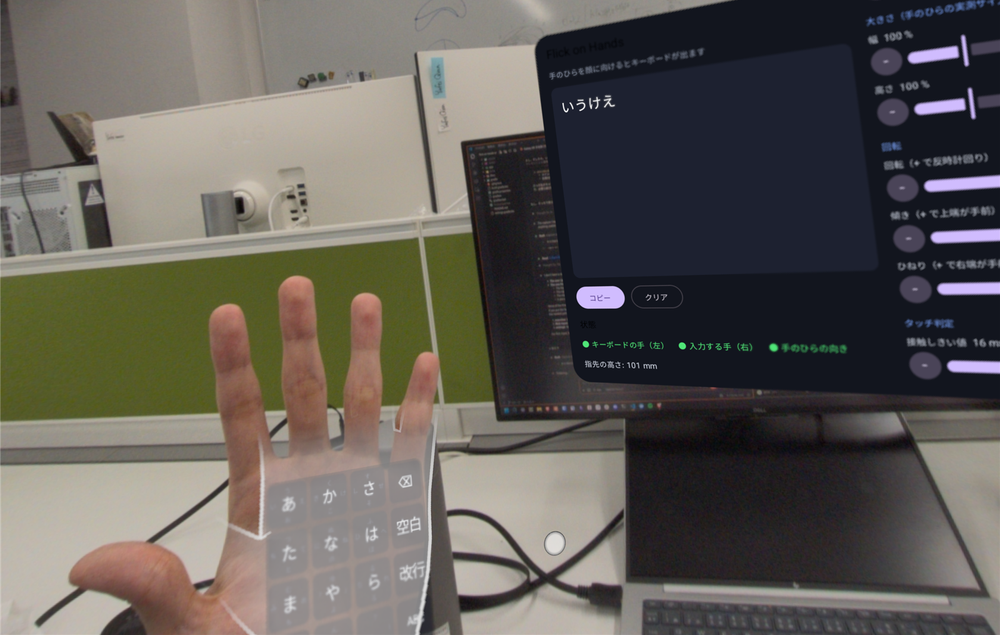

# Flick on Hands (Android XR)

Galaxy XR などの Android XR 端末向けのアプリ。片手の手のひらにフリックキーボードを表示し、もう片方の手の人差し指でフリック入力する。



## 特徴

- **手のひらに追従するキーボード**：ARCore for Jetpack XR のハンドトラッキングで手のひらの面を求め、その上にキーボードのパネルを置く。手のひらを顔に向けたときだけ表示する
- **手のひらサイズに自動で合わせる**：関節の位置から手のひら（指を除く部分）の大きさを測り、キーボードの大きさを合わせる
- **日本語フリック入力**：12 キー風の 4×4 配列。かな / ABC / 123 の切り替え、゛゜小（濁点・半濁点・小書き）、⌫・空白・改行
- **入力の様子が見える**：指先の位置をカーソルで表示し、押している間は上下左右の候補を十字に出す
- **スライダーで調整**：キーボードの位置・大きさ・回転と、接触の判定を調整できる。値は端末に保存される
- **フレーズ入力で自動調整**：短いフレーズを何回か打ってもらい、打ちやすさが最大になる設定をベイズ最適化で探す

## 動作環境

- Android XR 端末（Galaxy XR / SM-I610 で確認）
- Android Studio（同梱の JBR を JDK として使う）、Android SDK 37
- Jetpack XR 1.0.0-rc02（`androidx.xr.runtime` / `scenecore` / `arcore`）

## ビルドとインストール

```sh
# Windows (Git Bash) の例
export JAVA_HOME="/c/Program Files/Android/Android Studio/jbr"
./gradlew testDebugUnitTest assembleDebug
adb install -r -g app/build/outputs/apk/debug/app-debug.apk
```

`local.properties` に `sdk.dir` がない場合は、Android Studio で一度開くか、手で追加する。

## 使い方

1. アプリを起動すると Full Space に入る。初回はハンドトラッキングと頭のトラッキングの権限を許可する
2. **右手の手のひらを顔に向ける**と、手のひらの上にキーボードが出る（当面は右手に固定。学習のデータとモデルを片側に揃えるため）
3. 反対の手の人差し指でキーに触れ、上下左右に動かして指を離すと文字が確定する（触れて離すだけなら中央の文字）
4. 入力した文字はメインパネルに表示される。「コピー」でクリップボードに入るので、他のアプリに貼り付けられる


### キー配列（かなモード）

| | | | |
|---|---|---|---|
| あ | か | さ | ⌫ |
| た | な | は | 空白 |
| ま | や | ら | 改行 |
| ゛゜小 | わ | 、。？！ | ABC（モード切替） |

- 各キーの文字は「中央・左・上・右・下」の順（例：あ い う え お）。キーの四辺に候補を小さく表示している
- 「゛゜小」は直前の文字を 清音 → 濁音 → 半濁音 / 小書き の順に切り替える（ABC モードでは大文字 ↔ 小文字）

### 調整

メインパネルの右側で調整する。スライダーのほか、−／＋ ボタンで細かく動かせる。


| 項目 | 内容 |
|---|---|
| 奥行き（浮かせ量） | 手のひらからキーボード面までの距離 |
| 上下・左右 | 手のひら上での位置 |
| 幅・高さ | 手のひらの実測サイズに対する倍率 |
| 回転・傾き・ひねり | 面内の回転、左右の軸まわり、上下の軸まわりの回転 |
| 接触しきい値 | 指先がキーボード面からこの高さ未満になると「触れた」とみなす |

打鍵が反応しにくい・反応しすぎるときは、「状態」に出る「指先の高さ」を見ながら「奥行き」と「接触しきい値」を合わせる。手のひらに指が触れたときに「● 接触」と出れば合っている。

### 打鍵の判定

調整画面の「打鍵の判定」で選ぶ。

- **スライド**（初期値）：触れ始めのキーから、指を滑らせた向きでフリックの方向を決める。離した瞬間の動きも方向に含め、指先を見失ったらそこまでの動きで確定する
  - フリックとみなす移動量はキーの短辺の 0.7 倍（押してずらす判定は 0.4 倍）。単押しでも押している間に 1 cm ほど流れることがあるため
  - 押し直し：触れたまま、ほとんど横に動かずに 6 mm 上がってまた 6 mm 下がったら、そこで確定して次の打鍵を始める。⌫ の連打や「かき」のように同じキーを続けて打つとき、「離した」の高さまで指を上げないことが多いため
  - 浅い単押し（しきい値に届かず折り返した単押し）を拾う規則もあるが、初期値では無効（`SlideDetector(shallowTaps = true)`）。実機で試すと、押す前のためらいや面の近くでの上下の揺れまで単押しにしてしまい、かえって悪くなった
- **押してずらす**：触れている間のずれだけで方向を決める（以前の判定）
- **学習**：データ収集の記録で学習したモデルで、打鍵の候補を「打鍵ではない／単押し／フリック」に分け、フリックの方向は軌跡の向きで決める。しきい値に届かない浅い単押しも候補にする。学習の手順は [ml/README.md](ml/README.md)

どちらも「触れた」「離した」は指先の高さ（キーボード面 + 接触しきい値、離すときはさらに + 8 mm）で決める。

### 練習（記録）

メインパネルの「練習（記録）」を押すと、設定を変えずにフレーズ入力を 10 回繰り返し、軌跡を記録する（下の「記録した軌跡の再生」で使う）。試行の合間にスライダーで設定を変えてもよい。

### データ収集

学習用のデータを取るモード。提示したとおりに打ってもらい、提示したものを正解にする（フレーズ入力は訂正が混ざり、狙った文字を推定するしかないので、それよりきれいなラベルになる）。提示が変わるたびに音が鳴る。判定の結果では先に進まず（判定のくせがラベルに混ざらないように）、間違えても直さない。収集中は、押している間に十字に出るフリックの候補を出さない（気が取られるので）。

- **データ収集（1 打鍵）**：3 秒後から打鍵を 1 つずつ一定のテンポ（初期値 2.0 秒）で提示する。全部で 60 打鍵（約 2 分）。⌫ の連打や「かき」のような同じキーの連続、単押しを多めに混ぜる。判定の結果は参考に小さく出す
- **データ収集（単語）**：2〜5 文字の単語を 1 つずつ提示し、普段の速さで続けて 1 回打つ。1 語の時間は 1.5 秒 + 1 文字 0.7 秒。全部で 20 語（約 2 分）。1 打鍵ずつだと打鍵が孤立していて、続けて打つときの「打ち終わった指が低いまま次のキーへ移る」動きが学習に入らないため。濁点・半濁点・小書きは「元の文字 + ゛゜小」で打つ
- テンポは「速く」「遅く」で変えられる

### 自動調整（フレーズ入力 × ベイズ最適化）

メインパネルの「自動調整（BO）」を押すと始まる。全部で 15 回、3〜4 分かかる。

1. 最初に、キーボードのあたりを人差し指で手のひらに触れるまで何度かタップする（6 秒）。指先が止まる高さから手のひらの表面を測る
2. 表示されたひらがなのフレーズ（5 文字前後）を入力する。最初のキーを打った時点から計測が始まり、フレーズと一致するか 10 秒経つと次へ進む
3. 1 回ごとに、キーボードの奥行き・接触しきい値・上下・幅・高さを変える。1 回目は今の設定、2〜5 回目は探索範囲に散らした設定、6 回目からはベイズ最適化が選んだ設定になる
4. 終わると、試した中で最も良さそうな設定（事後平均が最大の設定）を適用する。試しに打ってみて「採用」か「元に戻す」を選ぶ

- 評価値は 1 秒あたりに正しく入力できた文字数。正しい文字数（目標の文字数 − 編集距離）から 1 を引き、経過時間で割る。誤りは編集距離で、⌫ による訂正は時間で評価値を下げる
- 探索範囲は開始時の値の近く（上下は ±15 mm、幅・高さは 75〜130 %、接触しきい値は 4〜20 mm）。先に手動でおおまかに合わせてから始めるとよい
- 奥行きは、測った手のひらの表面 + 2 mm から 15 mm の範囲だけを探す。手のひらの面は関節の中心から取っているので、皮膚はそれより 1 cm 以上外側にある。また評価値（打ちやすさ）だけでは「手の中に沈めて接触しきい値を大きくした設定」と区別がつかず、そのままでは手にめり込む設定が選ばれやすいため。表面を測れなかったときは、開始時の値より上だけを探す
- トラッキングが外れたなど、自分の打ち方以外の理由で失敗したときは「やり直し」を押す（記録せず、同じ設定で別のフレーズをやり直す）
- 自動調整・練習・データ収集 1 回ごとに、`/sdcard/Android/data/com.flickxr.app/files/sessions/<開始時刻>/` に記録が残る
  - `frames.csv`：フレームごとの指先（キーボード面上の位置・高さ、キーボードの実寸、判定の結果）
  - `joints.csv`：同じフレームの両手の全関節の位置、平滑化前の手のひらの面とキーボード面（ARCore の perception space、1e-5 m 単位の整数）
  - `trials.csv`：フレーズ入力の各回の結果
  - `prompts.csv`：データ収集で提示した打鍵と、提示した時刻（frames.csv と同じ時計）

### 記録した軌跡の再生

自動調整の記録を JVM で判定に流し直して、判定の方法どうしを比べられる。端末は要らない。

```sh
adb pull /sdcard/Android/data/com.flickxr.app/files/sessions logs/
./gradlew testDebugUnitTest --tests '*ReplayTest*' -PreplayDir=logs
```

結果は `logs/replay-report.txt` に出る。試行ごとに、目標のフレーズ・記録したときの入力・各判定で再生した入力（括弧内は編集距離）を並べ、最後に判定ごとの文字誤り率を出す。

- 実機で選べる判定（`SLIDE`、`THRESHOLD`）と、数値を変えた候補（`ReplayTest.kt` の `detectors` に足す）を並べる
- 記録したときと同じ判定で再生すると、記録と同じ結果になるはず。一致しない試行があればレポートに出す
- 記録中は実機の判定の結果を見ながら打ち、訂正しているので、比較は記録したときの判定に有利になる。また、高さのしきい値を変えた比較は当てにならない（指の上げ下げを実機のしきい値に合わせているため）。再生で比べられるのは、主に「キーと方向をどう決めるか」

### うまく表示されないとき

- 「状態」で、「キーボードの手」と「手のひらの向き」が ● になっているか確認する
- キーボードを出す手（左右）の設定が、実際に向けている手と合っているか確認する

## 構成

| ファイル | 役割 |
|---|---|
| `FlickLayout.kt` | キー配列とアクションの定義 |
| `FlickEngine.kt` | 押下・フリック方向・確定を判定するステートマシンとテキストバッファ（XR 非依存。単体テストあり） |
| `KanaModifier.kt` | 濁点・半濁点・小書きの巡回 |
| `HandKeyboard.kt` | 手の関節から手のひらの面を計算してパネルを置き、指先をキーボード面の座標に変換して判定に渡す |
| `FlickKeyboardView.kt` | キーボード、候補ポップアップ、指先カーソルの描画 |
| `KeyboardSettings.kt` / `SettingsStore.kt` | 手のひら基準の置き方（位置・回転・大きさ）と判定パラメータ、その保存 |
| `BayesOpt.kt` | ガウス過程（Matern 5/2）と期待改善量によるベイズ最適化（XR 非依存。単体テストあり） |
| `Calibration.kt` | 自動調整：探索するパラメータと範囲、フレーズ入力の評価値、試行の進行 |
| `KeyDetector.kt` | 指先の軌跡から打鍵を判定する（高さのしきい値による判定と、スライド判定）。XR 非依存で、記録を再生できる |
| `SessionLog.kt` | 自動調整中の軌跡と結果の記録（CSV） |
| `MainActivity.kt` / `MainScreen.kt` | 権限、XR セッションの設定、テキスト表示と調整 UI |

### 仕組みのポイント

- 手のひらの向きは、手首・中指の付け根・人差し指と小指の付け根の**位置だけ**から求めている（関節の回転の軸の取り方に依存しない）
- 計算は perception space（ARCore の関節座標系）で行い、パネルに設定する直前に activity space へ変換する
- 接触の判定は、オンとオフで閾値をずらしている（トラッキングの揺れで連打にならないように）

## Open problems

学習による判定まで含めた現状と、これからの対応は [docs/roadmap.md](docs/roadmap.md) にまとめている。

### キーボードの置き方と判定パラメータのキャリブレーション

キーボードの置き方（奥行き・上下・左右・幅・高さ・回転・傾き・ひねり）と接触しきい値は、今はユーザーがスライダーで手動調整している。最適な値は手の大きさ・厚み、トラッキングの癖、打鍵のしかたで人ごとに変わる。パラメータも多いため、手動では最適値に届きにくい。

#### ベイズ最適化（BO）による改善案

人に実際に打ってもらって評価する「人を評価のループに入れた最適化」として、BO で自動調整することを考えている。
フレーズ入力の速さを評価値にした最初の版を実装した（上の「自動調整」）。以下は、その先の改善案。1 回の評価のコストが高い、評価にノイズが乗る、パラメータが 10 個以下、という条件は BO に向いている。

ただし、すべてのパラメータを BO で探すのは効率が悪いので、次のように分けるのがよいと考えている。

1. **幾何的に決まるものは直接計測する**
   - 奥行き・上下・左右・傾き：指で手のひらの数か所に触れてもらい、平面を当てはめて求める
   - 接触しきい値：「触れている時」と「浮かせている時」の指先の高さを記録し、その分布の境目から決める
   - 10 秒程度で済み、BO で数十回の試行をするより速い
2. **正解がなく好みで決まるものだけを BO で探す**
   - 大きさ・縦横比・わずかな傾きなど 2〜4 個に絞る
   - 2 つの設定を比べて「どちらが打ちやすいか」を答えてもらう方式（好みの比較で進める BO）にすると、1 回の試行を短くできる
3. **入力中のデータで補正し続ける**
   - 「狙ったキーと実際に触れた位置のずれ」を学習して、打鍵位置を補正する（タッチパネルの打鍵位置補正と同じ発想）

#### 未検討の課題

- 目的関数の設計（誤入力率・入力速度・主観評価の重み付け、多目的にするか）
- 試行回数の上限と、ユーザーの慣れや疲れによる目的関数の変化への対処
- 安全な探索範囲と、人ごとの初期値（事前分布）の決め方
- 評価の比較対象として、直接計測だけのキャリブレーションを用意すること
- そもそも誤入力が何から来ているか（位置ずれ・接触判定・指が手のひらに重なったときのトラッキングの欠落）を、ログで切り分けること。センシング側の限界が主な原因なら、パラメータ調整では改善しない

なお、キーボード自体を手でつまんで動かす調整方法も試したが、採用しなかった。

## 未対応

- かな漢字変換
- 他のアプリへの直接入力（IME 化）。今はクリップボード経由
